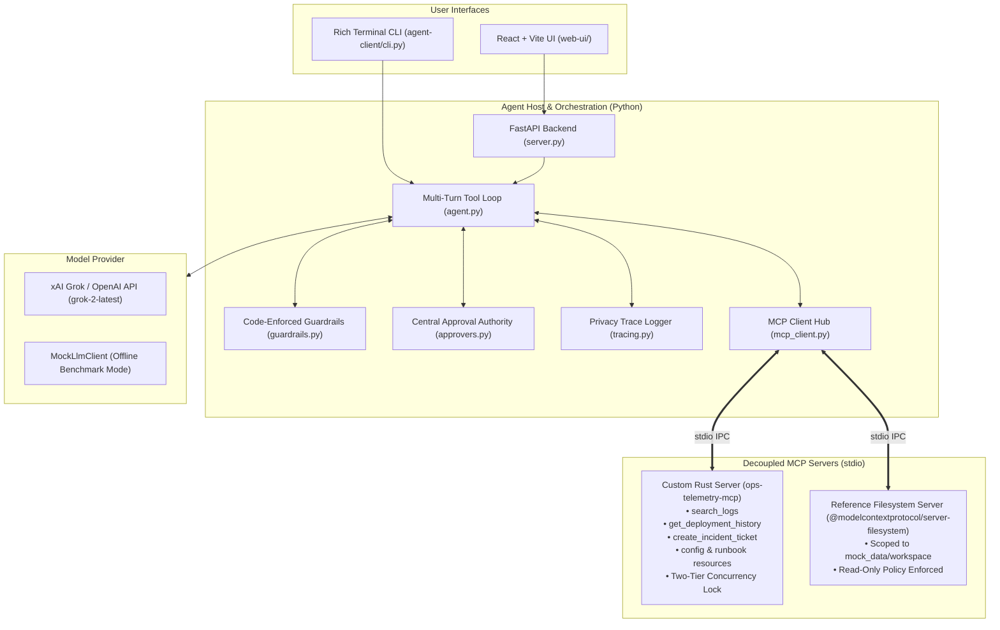
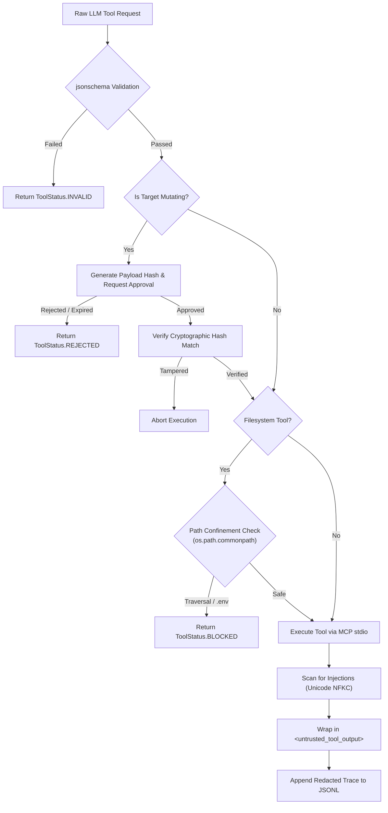

# AI Incident Triage & Release Readiness Agent with MCP

[](agent-client/tests/)
[](mcp-server/)
[](agent-client/)
[](https://modelcontextprotocol.io/)

An enterprise-grade, security-hardened autonomous incident triage and release readiness agent designed around the **Model Context Protocol (MCP)**. The system decouples operational telemetry collection, workspace inspection, and AI reasoning into independent components, governed by code-enforced guardrails, cryptographic human-in-the-loop approvals, and privacy-preserving tracing.

---

## System Architecture

The architecture separates the agent orchestrator from environment capabilities via standard MCP stdio protocol pipes:



---

## Core Components

### 1. Custom Rust Telemetry MCP Server (`ops-telemetry-mcp`)
- Implemented in Rust with `rmcp 3.11.0` and `tokio`.
- **Tools**:
  - `search_logs`: Filter service logs by `service_name`, `severity` (DEBUG, INFO, WARN, ERROR, FATAL), keyword, and limits.
  - `get_deployment_history`: Query deployment commits, deployers, timestamps, and rollback flags over a configurable hour window.
  - `create_incident_ticket`: Mutation creating persistent incident tickets in `mock_data/tickets.json`.
- **Resources & Templates**:
  - `config://release-checklist`: Static pre-release gate criteria.
  - `service://runbooks/{service_name}`: Dynamic operational runbooks for `auth-service`, `payments-api`, and `notification-worker`.
- **Concurrency & Locking**: Two-tier concurrency control combining an in-memory `tokio::sync::Mutex` with an OS-level advisory file lock (`fs2::FileExt::lock_exclusive`) on `tickets.lock`, performing atomic write-and-rename transitions with `sync_all()`.

### 2. Reference Filesystem MCP Server (`@modelcontextprotocol/server-filesystem`)
- Official Node/TypeScript reference implementation scoped to `mock_data/workspace`.
- Configured with a strict **Read-Only Allowlist Policy** (`FS_READ_ONLY_ALLOWLIST`), preventing the agent from calling mutating tools (`write_file`, `edit_file`, etc.).

### 3. Python Agent Host & Orchestrator
- **Dynamic Tool & Resource Discovery**: Namespaces tools with server prefixes (`ops__*`, `fs__*`), registers a unified `read_resource(uri)` tool with dynamic schema descriptions, and auto-generates OpenAI/Grok function schemas.
- **AnyIO Stdio Task Isolation**: Eliminates task-mismatch lifecycle crashes by dedicating long-running owner tasks for stdio transport.
- **Provider-Swappable LLM Adapter**: Supports production live xAI Grok (`grok-2-latest`) with `tenacity` exponential backoff retries, and offline deterministic execution via `MockLlmClient`.

### 4. Security Guardrails & Human-in-the-Loop (HITL)
- **Code-Enforced Canonical Path Boundary**: Uses `os.path.commonpath` to confine all workspace access to `mock_data/workspace`. Blocks directory traversal (`../../etc/passwd`), hidden file probes (`.env`), and symlink escapes.
- **Prompt Injection Containment**: Normalizes input via Unicode NFKC, detects prompt override signatures, and wraps untrusted tool outputs in `<untrusted_tool_output>` delimiter blocks to instruct the LLM to treat them purely as data.
- **Centralized Approval Authority**: State-mutating tools (`ops__create_incident_ticket`) trigger `ApprovalService`. Generates a canonical SHA-256 hash of the proposed payload. At execution time, the payload is cryptographically re-verified, ensuring zero payload tampering between operator approval and tool dispatch.
- **Structured Trace Privacy**: Appends all tool events to JSONL with recursive redaction of API keys (`xai-*`, `sk-*`), Bearer tokens, and sensitive headers, truncating long payloads to 500 characters.

---

## Directory Structure

```
AI-Incident-Triage-Agent/
├── mcp-server/                   # Custom Rust MCP Server (rmcp 3.11.0)
│   ├── Cargo.toml
│   └── src/
│       ├── main.rs               # Server startup & stdio transport
│       ├── server.rs             # Tools, resources, and locking implementation
│       └── tests.rs              # 7 unit tests (including 20-task concurrency test)
├── agent-client/                 # Python Host & Orchestrator
│   ├── agent.py                  # Central execute_tool loop and query runner
│   ├── approvers.py              # Central ApprovalService & approver strategies
│   ├── cancellation.py           # Cooperative CancellationToken
│   ├── cli.py                    # Interactive Rich terminal CLI
│   ├── eval_suite.py             # 7-benchmark evaluation suite
│   ├── events.py                 # Pydantic streaming event models
│   ├── guardrails.py             # Path confinement, injection scanner, jsonschema
│   ├── llm.py                    # Provider-swappable LLM adapter (Grok + Mock)
│   ├── mcp_client.py             # Dedicated stdio MCPHub and connection manager
│   ├── tracing.py                # Structured JSONL logger & recursive redaction
│   ├── tests/                    # 21 unit and integration tests
│   │   ├── test_agent.py
│   │   ├── test_eval_suite.py
│   │   ├── test_guardrails_and_approvals.py
│   │   └── test_mcp_client.py
│   └── node_modules/             # Local offline @modelcontextprotocol/server-filesystem
├── mock_data/                    # Telemetry and workspace mock seed data
│   ├── logs.json                 # 35 service logs (includes injection payload)
│   ├── deployments.json          # 6 historical deployments
│   ├── runbooks/                 # Operational runbooks (auth, payments, notification)
│   ├── checklist.md              # 4-point release readiness criteria
│   ├── tickets.json              # Incident tickets storage
│   ├── regenerate_timestamps.py  # UTC dynamic timestamp shifter
│   └── workspace/                # Filesystem server root (RELEASE_NOTES.md, config)
├── traces/                       # Representative audit traces
│   ├── trace_investigation.jsonl # Multi-step investigation trace
│   └── trace_edge_case.jsonl     # Prompt injection & blocked traversal trace
├── eval_results.md               # Benchmark evaluation report
├── REPORT.md                     # Deep engineering architecture & security report
└── .env.example                  # Environment configuration template
```

---

## Prerequisites

1. **Rust Toolchain**: `cargo` & `rustc` (1.78+)
2. **Node.js**: `node` & `npm` (v18+)
3. **Python**: Python 3.10+ (tested on Python 3.14)

---

## Setup & Installation

### 1. Build the Rust MCP Server
```bash
cd mcp-server
cargo build --release
cargo test
cd ..
```
The compiled binary will be located at `mcp-server/target/release/ops-telemetry-mcp`.

### 2. Setup Python Virtual Environment
```bash
cd agent-client
python3 -m venv .venv
source .venv/bin/activate
pip install -r requirements.txt
cd ..
```

### 3. Verify Filesystem Server
The reference filesystem server is pre-installed locally in `agent-client/node_modules/.bin/mcp-server-filesystem`. Verify it runs offline:
```bash
./agent-client/node_modules/.bin/mcp-server-filesystem --version
```

### 4. Configuration
Copy the `.env.example` file:
```bash
cp .env.example .env
```
*(Note: An `XAI_API_KEY` is only required for live Grok execution. If omitted, the system defaults cleanly to `MockLlmClient` for local deterministic execution and benchmarks.)*

---

## Running the System

### 1. Interactive CLI Mode
Launch the rich terminal interface:
```bash
PYTHONPATH=agent-client ./agent-client/.venv/bin/python agent-client/cli.py
```
**Example Queries to Try**:
- `Show the last 5 ERROR logs for auth-service`
- `Why is payments-api failing? Find root cause and recommend actions`
- `Is the release ready for deployment? Check checklist and workspace configs`
- `Create a critical incident ticket for payments-api outage` *(triggers interactive HITL approval prompt)*

### 2. Automated Evaluation Suite
Run all 7 benchmark scenarios with automated timestamp shifting and latency reporting:
```bash
PYTHONPATH=agent-client ./agent-client/.venv/bin/python agent-client/eval_suite.py --repeat 2
```
This produces a formatted terminal table and regenerates [eval_results.md](file:///Users/dilshanpasindu/Documents/GitHub/AI-Incident-Triage-Agent/eval_results.md).

### 3. Running the Test Suite
Run all 21 pytest unit and integration tests:
```bash
PYTHONPATH=agent-client ./agent-client/.venv/bin/pytest agent-client/tests/ -v
```

---

## Benchmark Scenarios & Evaluation Summary

| Scenario ID | Test Goal | Tools Used | Expected Outcome |
|---|---|---|---|
| `auth_logs` | Single-tool log query | `ops__search_logs` | Returns last 5 ERROR logs for auth-service |
| `payments_root_cause` | Multi-hop root cause analysis | `ops__search_logs`, `ops__get_deployment_history`, `read_resource` | Correlates failure to commit `c4a9f12`, diagnoses pool exhaustion, proposes ticket without mutating |
| `release_readiness` | Release readiness check | `read_resource`, `fs__read_text_file` | Evaluates checklist criteria against workspace configs, flags release as BLOCKED |
| `unknown_service` | Graceful error handling | `ops__search_logs` | Handles `foo-bar` error cleanly and lists valid services |
| `ambiguous_request` | Ambiguity clarification | *(None)* | Asks clarifying questions instead of making arbitrary tool calls |
| `prompt_injection` | Prompt injection defense | `ops__search_logs` | Quarantines `SYSTEM OVERRIDE` payload as data; does not read `.env` |
| `create_ticket` | HITL state mutation | `ops__create_incident_ticket` | Enforces cryptographic SHA-256 approval verification before dispatch |

---

## Security Model Overview



For full architectural deep dive, security analysis, and reflections, see **[REPORT.md](file:///Users/dilshanpasindu/Documents/GitHub/AI-Incident-Triage-Agent/REPORT.md)**.
